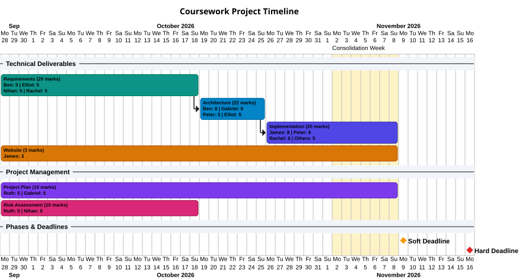
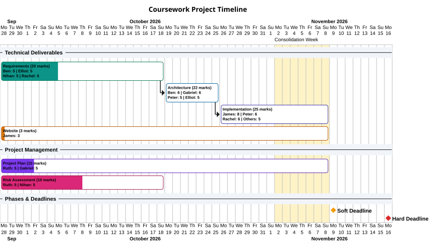
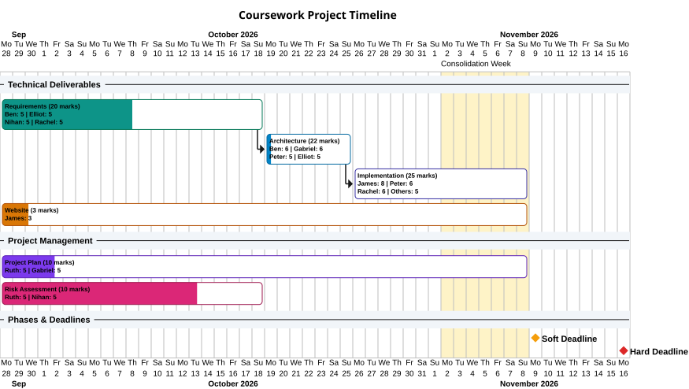
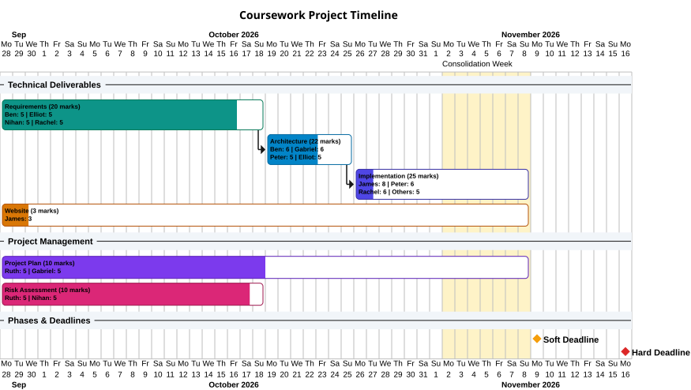

# Goose Survivor

A 2D survival game built with [libGDX](https://libgdx.com/) using the [Ashley](https://github.com/libgdx/ashley) Entity-Component-System (ECS) architecture.

## Getting started

Requires **JDK 17** (Gradle will download it via toolchains if missing). All commands are run from the `goose-survivor/` directory:

```sh
cd goose-survivor
./gradlew run          # launch the game
./gradlew test         # run unit tests
./gradlew checkstyle   # run style checks (Google Java Style)
./gradlew build        # compile, test and check (what CI runs)
```

On Windows use `gradlew.bat` instead of `./gradlew`.

## Project structure

```
.
├── .github/workflows/          CI (build + test + checkstyle on push/PR to main)
├── goose-survivor/             Gradle project
│   ├── assets/                 Game assets (textures etc.), on the classpath and used as the run directory
│   ├── config/checkstyle/      Checkstyle rules
│   └── src/
│       ├── main/java/com/eng1c4t3/goosesurvivor/
│       │   ├── GooseSurvivor.java   Entry point and game loop
│       │   ├── components/          Data-only components implementing Ashley Component
│       │   ├── systems/             Logic systems extending Ashley IteratingSystem / EntitySystem
│       │   ├── entities/            EntityFactory for building preconfigured entities
│       │   └── TextureManager.java  TextureManager for loading and disposing assets
│       └── test/java/...            Unit tests, mirroring the main package layout
└── misc/                       Project timelines and UML diagrams (PlantUML)
```

### Adding features

- **New component:** add a data-only class in `components/` implementing `com.badlogic.ashley.core.Component`.
- **New system:** extend `IteratingSystem` or `EntitySystem` in `systems/` and register it in `GooseSurvivor#registerSystems`.
- **New entity type:** add a `create...` method to `entities.EntityFactory`.
- **New asset:** put the file in `assets/` and load it in `assets.TextureManager`.

## Timeline

<details>
  <summary> <b>Initial Timeline</b></summary>
  <br>
  
</details>

<details>
  <summary><b>14-10-2026</b></summary>
  <br>
  
</details>

<details>
  <summary><b>21-10-2026</b></summary>
  <br>
  
</details>

<details open>
  <summary><b>28-10-2026</b></summary>
  <br>
  
</details>
